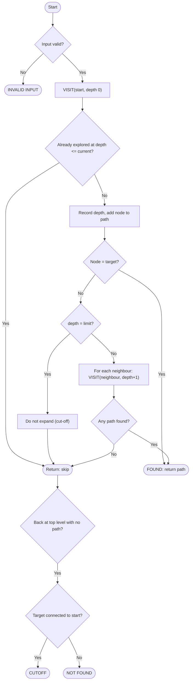

# Laboratory Report

## 1. Experiment No.
Experiment No. ____  (fill in the number given by your instructor)

## 2. Title
Searching Within a Limited Area: implementation of **Depth-Limited Search (DLS)** on a rescue-map graph

## 3. Aim
To implement Depth-Limited Search so that a rescue team can locate a missing person on a graph of connected
locations while searching no deeper than a specified number of levels from the starting location.

## 4. Problem Statement
A rescue team is looking for a missing person in an area represented as connected locations. Due to limited
resources, the team can search only up to a specified number of levels from the starting location. Develop a
program to locate the target while respecting this limitation.
Lab size: 10-15 locations, 15-20 connections, depth limit 2-4. (Used here: 14 locations, 17 connections.)

## 5. Objectives
1. Model the area as an undirected graph stored as an adjacency list.
2. Implement DLS with a strict depth cut-off and cycle protection.
3. Return the path, explored nodes, depth information, step log and cut-off information, not just True/False.
4. Distinguish **FOUND**, **CUTOFF** and **NOT FOUND**.
5. Test with reachable, too-deep and unreachable targets, cycles and depth limits 0 and 1.

## 6. Theory
**Graph.** G = (V, E): nodes are locations, edges are connections. Here the graph is undirected and unweighted.

**Depth.** The number of edges from the start node. Start = 0.

**Depth-First Search (DFS).** Explores one branch completely before trying another, using a stack (or recursion).
Memory use is small, but without a limit it may go very deep, and it can loop forever on graphs with cycles unless
visited nodes are tracked.

**Depth-Limited Search (DLS).** DFS with a maximum depth L. A node at depth L is tested against the goal but is not
expanded. DLS has two kinds of failure:
- **failure**: the whole reachable space was searched, no target;
- **cutoff**: the search was stopped by the limit, so a target may exist deeper.

**Properties.** Time O(b^L), space O(b·L) for the tree version. Complete only if the target is at depth ≤ L. Not optimal.

**Cycle handling in this experiment.** The program stores, for every node, the shallowest depth at which it has been
explored. A node is skipped if it was already explored at the same or smaller depth. It is explored again if it is
reached by a shorter route. (A simple visited set would be incorrect for DLS, because a node first reached near the
limit by a long route would block the short route and the target could be missed.)

**Why DLS fits the problem.** The rescue team's budget is "at most L levels from the base": this is exactly the depth limit.

## 7. Algorithm
1. Validate the input (graph not empty, start and target exist, depth limit is an integer ≥ 0).
2. Set `best_depth = {}`. Call `VISIT(start, 0, [])`.
3. In `VISIT(node, depth, path)`:
   a. If the node was already explored at a depth ≤ `depth`, return failure (cycle/duplicate).
   b. Record `best_depth[node] = depth`; append the node to the path.
   c. If the node is the target, return the path.
   d. If `depth == L`, note the unexplored neighbours as "skipped by limit" and return failure. **Do not go deeper.**
   e. Otherwise call `VISIT(neighbour, depth + 1, path)` for each neighbour, in order; return the first path found.
4. If no path was found, check whether the target is connected to the start. If yes, the result is **CUTOFF**;
   if not, **NOT FOUND**.

## 8. Pseudocode
```
function DEPTH_LIMITED_SEARCH(graph, start, target, L)
    if input is invalid then return INVALID_INPUT
    best_depth <- empty map
    path <- VISIT(start, 0, [])
    if path exists then return FOUND(path)
    if target is connected to start then return CUTOFF
    else return NOT_FOUND

function VISIT(node, depth, path)
    if node in best_depth and best_depth[node] <= depth then return none
    best_depth[node] <- depth
    path <- path + [node]
    if node = target then return path
    if depth = L then return none            // limit reached: do not expand
    for each neighbour in graph[node] do
        result <- VISIT(neighbour, depth + 1, path)
        if result exists then return result
    return none
```

## 9. Flowchart


## 10. Implementation
| File | Role |
|------|------|
| `dls.py` | `depth_limited_search()`, `SearchResult`, `Step`, and the diagnostic `shortest_distance()` |
| `graph_data.py` | default map, `build_graph()` validation, text parsing for the custom graph |
| `app.py` | Streamlit interface, Graphviz drawing, replay slider, explanations |
| `test_dls.py` | 25 unit tests including 300 random graphs checked against BFS |

**Default map (adjacency list, distance from Base Camp in brackets):**
Village(1), Forest(1), River(1), School(2), Market(2), Hill(2), Bridge(2), Hospital(3), Temple(3),
Railway Station(3), Police Station(4); Mountain and Cave form a separate area that cannot be reached.

**Screen layout.** *Sidebar:* algorithm (fixed to DLS), graph source, start, target, maximum depth, Search, Reset.
*Main page, top to bottom:* title and description; graph picture with legend; search configuration; search execution
summary; result box (green = found, yellow = cutoff, red = unreachable); path table; eight statistics; grouped-by-depth
list, exploration table and replay slider; explanation tabs (key ideas, worked example, BFS vs DFS vs DLS).

Run: `pip install -r requirements.txt` then `streamlit run app.py`.

## 11. Input
Start = Base Camp, Target = Hospital, Depth limit = 3, default rescue map.

## 12. Output
```
TARGET FOUND
Target: Hospital   Starting location: Base Camp   Search depth limit: 3
Path: Base Camp → Village → School → Hospital   Depth where found: 3   Nodes explored: 4

Step  Node       Depth  Parent    Action
1     Base Camp  0      -         Explore neighbours (Village, Forest, River)
2     Village    1      Base Camp Explore neighbours (Base Camp, School, Market)
3     Base Camp  2      Village   Already explored at depth 0: skipped
4     School     2      Village   Explore neighbours (Village, Hospital)
5     Village    3      School    Already explored at depth 1: skipped
6     Hospital   3      School    Target found at depth 3
```
Statistics: 14 locations, 17 connections, limit 3, 4 nodes visited, max depth reached 3, path length 3, 0 nodes skipped.

## 13. Test Cases
| # | Scenario | Start → Target, limit | Actual result (verified) |
|---|----------|-----------------------|--------------------------|
| 1 | Found within limit | Base Camp → Hospital, 3 | FOUND, Base Camp → Village → School → Hospital |
| 2 | Found at depth 2 | Base Camp → Market, 2 | FOUND, Base Camp → Village → Market |
| 3 | Beyond limit | Base Camp → Police Station, 3 | CUTOFF (Police Station is 4 levels away), max depth 3 |
| 4 | Enough depth | Base Camp → Police Station, 4 | FOUND, path length 4 |
| 5 | Unreachable | Base Camp → Mountain, 3 | NOT FOUND (different area) |
| 6 | Start = target | Village → Village, 0 | FOUND, path = [Village] |
| 7 | Limit 0 | Base Camp → Village, 0 | CUTOFF, only Base Camp visited, 3 skipped |
| 8 | Limit 1 | Base Camp → School, 1 | CUTOFF, 4 nodes visited, max depth 1 |
| 9 | Cycle | triangle A-B-C + isolated Z, 50 | terminates, NOT FOUND |
| 10 | Chain A-B-C-D | A → D, 2 | CUTOFF (D at depth 3); with limit 3: FOUND |
| 11 | Invalid input | empty graph / unknown place / limit -1 | INVALID INPUT, no crash |

`python -m unittest -v test_dls` → **Ran 25 tests ... OK**.

## 14. Result
DLS found every target that lay within the depth limit and never explored a node deeper than the limit, in the
default map and in 300 random graphs. Targets beyond the limit gave CUTOFF, unreachable targets gave NOT FOUND,
and cycles and invalid input caused no crash or endless loop.

## 15. Complexity Analysis
- **Time:** O(b^L) for the tree version. With the depth-aware cycle check used here, each node is explored at most
  L + 1 times, so the running time is O(L · (V + E)).
- **Space:** O(V) for `best_depth`, plus O(L) for the recursion stack.
- **Completeness:** complete only when the target is at depth ≤ L. **Optimality:** not optimal.

## 16. Applications
Search and rescue with a limited search radius; game playing with a move limit; web crawling with a link-depth
limit; network discovery within N hops; Iterative Deepening DFS (which repeats DLS with L = 0, 1, 2, ...).

## 17. Limitations
The target is missed if L is too small; the path found may not be the shortest; edges are unweighted; recursion and the
picture suit small graphs only.

## 18. Conclusion
Depth-Limited Search was implemented and verified. It reduces DFS's risk of going too deep by adding a depth cut-off, matches
the rescue team's limited-resource constraint, and reports clearly whether the target was found, is beyond the limit, or is
unreachable.

## 19. Viva Questions and Answers

**Q1. What is Depth-Limited Search?**
DFS that is not allowed to go deeper than a fixed limit L. Nodes at depth L are checked but not expanded.

**Q2. Why is the depth limit needed?**
Plain DFS can go very deep, or forever on an infinite or cyclic space. The limit bounds the search and models a limited resource such as the rescue team's budget.

**Q3. What is the depth of the start node?**
0. Its neighbours have depth 1, and so on.

**Q4. What does CUTOFF mean and how is it different from NOT FOUND?**
CUTOFF: the search was stopped by the limit, so the target may exist deeper. NOT FOUND: the target is unreachable, so no limit would find it. In this program CUTOFF is reported only if the target really is reachable but deeper than L.

**Q5. What happens if L = 0?**
Only the start node is examined. It is FOUND if start = target, otherwise CUTOFF (if the start has neighbours).

**Q6. How does your program avoid infinite loops on cycles?**
It stores the shallowest depth at which each node was explored and skips a node already explored at the same or a smaller depth.

**Q7. Why not use a simple visited set?**
A node first reached deep (near the limit) by a long route would be marked visited, and the shorter route to it would be blocked, so a target within the limit could be missed. Re-exploring a node when it is reached at a smaller depth fixes this. There is a unit test for exactly this case.

**Q8. Is DLS complete? Optimal?**
Complete only if the target is at depth ≤ L. Not optimal: it returns the first route found, not the shortest.

**Q9. Time and space complexity?**
Time O(b^L), space O(b·L) for the tree version. This implementation: time O(L·(V+E)), space O(V) plus O(L) stack.

**Q10. How is DLS different from BFS?**
BFS explores level by level with a queue, needs much memory (O(b^d)) and finds the shortest path. DLS goes depth-first with a stack, uses little memory, has a depth cut-off and does not guarantee the shortest path.

**Q11. What is Iterative Deepening DFS?**
It runs DLS with L = 0, 1, 2, ... until the target is found. It combines the low memory of DFS with the completeness and shortest-path property of BFS.

**Q12. What if the depth limit is larger than the graph's depth?**
The limit is never reached, DLS behaves like ordinary DFS with a cycle check, and it can only return FOUND or NOT FOUND.

**Q13. Where does the program check the target?**
When a node is visited, before its neighbours are explored. So a node exactly at depth L can still be the target.

**Q14. How is the path reconstructed?**
The current path (list of nodes from the start) is passed down the recursion. When the target is reached, that list is returned.

**Q15. How do you know the limit is really enforced?**
The code recurses only when `depth < L`. Tests check that no explored node and no log step exceeds L, and that on 300 random graphs DLS finds the target exactly when its true distance is ≤ L.

**Q16. Is this an AI/ML project?**
It is an AI *search* project. DLS is a classical uninformed search algorithm. No learning or machine-learning model is used.
